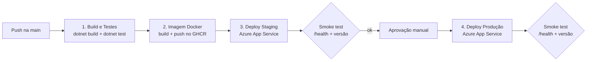
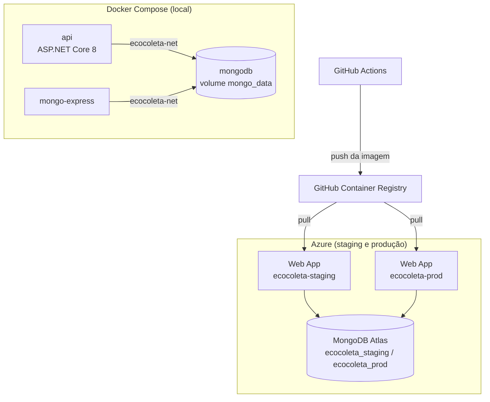

# Projeto - Cidades ESGInteligentes

## EcoColeta — Plataforma de Gestão de Resíduos e Reciclagem

**Aluna:** Veronica Goulart Santos Cardoso — **RM:** rm557663
**Disciplina:** Navegando pelo mundo DevOps — FIAP

A **EcoColeta** é uma API REST em **C# / ASP.NET Core 8** com **MongoDB** que monitora pontos de coleta seletiva, emite alertas automáticos quando um ponto atinge o limite de capacidade, registra as coletas com rastreabilidade do destino de cada material e notifica os cidadãos sobre o descarte correto. A aplicação dá continuidade ao projeto ESG desenvolvido na disciplina de NoSQL (mesmas 5 collections), agora com um ciclo de vida DevOps completo: build, testes, containerização, orquestração e deploy automatizado em **staging** e **produção** no Azure.

| Pilar ESG | Como a aplicação atende |
|---|---|
| **Ambiental (E)** | Monitoramento do nível dos pontos de coleta, alertas de capacidade e relatório de CO₂ evitado e água economizada |
| **Social (S)** | Cadastro de cidadãos e empresas, gamificação por descarte correto e orientações de destinação |
| **Governança (G)** | Rastreabilidade de cada coleta (peso, destino, operador, incidentes) e histórico de notificações |

### Ambientes publicados

| Ambiente | URL | Swagger |
|---|---|---|
| Staging | https://ecocoleta-staging-rm557663.azurewebsites.net | `/swagger` |
| Produção | https://ecocoleta-prod-rm557663.azurewebsites.net | `/swagger` |

> A rota `/` de cada ambiente mostra o nome do ambiente (`Staging` / `Production`) e a versão implantada (SHA do commit). A rota `/health` mostra o estado da aplicação e da conexão com o MongoDB.

---

## Como executar localmente com Docker

**Pré-requisitos:** Docker Desktop (ou Docker Engine + Docker Compose v2) e Git.

1. Clone o repositório e entre na pasta do projeto:
   ```bash
   git clone https://github.com/VeronicaGSC/ecocoleta.git
   cd ecocoleta
   ```
2. Crie o arquivo de variáveis de ambiente a partir do modelo:
   ```bash
   cp .env.example .env
   ```
3. Suba toda a infraestrutura (API + MongoDB + Mongo Express):
   ```bash
   docker compose up -d --build
   ```
4. Confira se os contêineres estão saudáveis:
   ```bash
   docker compose ps
   ```
5. Acesse:
   - API / Swagger: http://localhost:8080/swagger
   - Status do ambiente: http://localhost:8080/
   - Health check: http://localhost:8080/health
   - Mongo Express (interface do banco): http://localhost:8081 (usuário e senha definidos no `.env`)

Na primeira inicialização a API cria os índices e carrega automaticamente os dados de exemplo nas 5 collections (10 documentos em cada).

Comandos úteis:
```bash
docker compose logs -f api      # acompanhar logs da API
docker compose down             # parar os contêineres (mantém os dados no volume)
docker compose down -v          # parar e apagar também o volume do banco
```

### Executar sem Docker (opcional)
```bash
dotnet test EcoColeta.sln                       # roda os testes
dotnet run --project src/EcoColeta.Api          # requer um MongoDB em localhost:27017
```

### Principais endpoints

| Método | Rota | Descrição |
|---|---|---|
| GET/POST | `/api/pontos-coleta` | Lista / cadastra pontos de coleta |
| GET/PUT/DELETE | `/api/pontos-coleta/{id}` | Consulta / atualiza / remove um ponto |
| GET | `/api/pontos-coleta/alertas` | Pontos que atingiram o limite e precisam de coleta |
| POST | `/api/pontos-coleta/{id}/leituras` | Registra leitura do sensor IoT e gera alerta automático |
| GET/POST | `/api/coletas` | CRUD de coletas · `GET /api/coletas/ponto/{codigo}` histórico por ponto |
| GET/POST | `/api/usuarios` | CRUD de usuários · `GET /api/usuarios/ranking` · `POST /api/usuarios/{id}/recompensas` |
| GET/POST | `/api/notificacoes` | CRUD de notificações · `GET /api/notificacoes/nao-lidas` · `PATCH /api/notificacoes/{id}/lida` |
| GET/POST | `/api/materiais` | CRUD do catálogo · `GET /api/materiais/categoria/{categoria}` orientação de descarte |
| GET | `/api/relatorios/esg` | Indicadores ESG: peso reciclado por material, CO₂ evitado, água economizada |
| GET | `/health` | Health check (aplicação + MongoDB) |

---

## Pipeline CI/CD

**Ferramenta:** GitHub Actions — arquivo [`.github/workflows/ci-cd.yml`](.github/workflows/ci-cd.yml).

A pipeline é disparada a cada `push` na branch `main` (e também manualmente, via *workflow_dispatch*). Em *pull requests* ela executa apenas build e testes, funcionando como verificação de qualidade antes do merge.



| Etapa | O que faz |
|---|---|
| **1. Build e Testes** | Instala o .NET 8, restaura as dependências, compila em modo Release e executa os 28 testes automatizados (xUnit). O relatório `.trx` é publicado como artefato da execução. Se algum teste falhar, a pipeline para aqui. |
| **2. Build e Push da Imagem Docker** | Constrói a imagem a partir do `Dockerfile` e publica no GitHub Container Registry com duas tags: o SHA do commit (versão imutável e rastreável) e `latest`. O SHA também é gravado dentro da imagem (`APP_VERSION`). |
| **3. Deploy - Staging** | Publica a imagem exata gerada no passo 2 no Web App de staging do Azure (`ecocoleta-staging-rm557663`). Em seguida, o script `scripts/smoke-test.sh` aguarda a nova versão subir e valida que o `/health` responde `Healthy` e que a versão em execução é a do commit. |
| **4. Deploy - Produção** | Só começa se o staging passar no smoke test **e** após aprovação manual (regra *Required reviewers* do environment `production` no GitHub). Faz o deploy da **mesma imagem** no Web App de produção e repete o smoke test. |

**Lógica e boas práticas adotadas:**
- *Build once, deploy many*: a imagem é construída uma única vez e promovida de staging para produção, garantindo que o que foi validado é exatamente o que vai ao ar.
- Configurações por ambiente ficam nos **GitHub Environments** (`staging` e `production`): cada um tem a variável `AZURE_WEBAPP_NAME` e o secret `AZURE_WEBAPP_PUBLISH_PROFILE`. Nenhuma credencial fica no código.
- Cada ambiente usa um banco de dados separado no MongoDB Atlas (`ecocoleta_staging` e `ecocoleta_prod`), configurado via variáveis de ambiente do App Service.
- O *smoke test* impede que uma versão quebrada em staging seja promovida para produção.

---

## Containerização

### Dockerfile

```dockerfile
# syntax=docker/dockerfile:1
# =====================================================================
# EcoColeta API — Dockerfile multi-stage
#   Estágio 1 (build):   SDK do .NET compila e publica a aplicação
#   Estágio 2 (runtime): imagem enxuta só com o runtime ASP.NET
# =====================================================================

# ---------- Estágio 1: build ----------
FROM mcr.microsoft.com/dotnet/sdk:8.0 AS build
WORKDIR /source

# Copia apenas o .csproj primeiro para aproveitar o cache de camadas do restore
COPY src/EcoColeta.Api/EcoColeta.Api.csproj src/EcoColeta.Api/
RUN dotnet restore src/EcoColeta.Api/EcoColeta.Api.csproj

# Copia o restante do código e publica em modo Release
COPY src/ src/
RUN dotnet publish src/EcoColeta.Api/EcoColeta.Api.csproj \
    -c Release -o /app/publish --no-restore /p:UseAppHost=false

# ---------- Estágio 2: runtime ----------
FROM mcr.microsoft.com/dotnet/aspnet:8.0 AS runtime
WORKDIR /app

# Versão da imagem (a pipeline injeta o SHA do commit)
ARG APP_VERSION=local
ENV APP_VERSION=${APP_VERSION} \
    ASPNETCORE_URLS=http://+:8080 \
    ASPNETCORE_ENVIRONMENT=Production

# curl é usado apenas pelo HEALTHCHECK
RUN apt-get update \
    && apt-get install -y --no-install-recommends curl \
    && rm -rf /var/lib/apt/lists/*

COPY --from=build /app/publish .

# Segurança: executa com usuário não-root (já existente na imagem oficial)
USER $APP_UID

EXPOSE 8080

HEALTHCHECK --interval=30s --timeout=5s --start-period=20s --retries=3 \
    CMD curl -fs http://localhost:8080/health || exit 1

ENTRYPOINT ["dotnet", "EcoColeta.Api.dll"]
```

### Estratégias adotadas

- **Multi-stage build:** o estágio `build` usa a imagem do SDK (pesada) para compilar; o estágio final usa apenas o runtime ASP.NET, o que reduz bastante o tamanho da imagem e a superfície de ataque.
- **Cache de camadas:** o `.csproj` é copiado e restaurado antes do restante do código, então o `dotnet restore` só é refeito quando as dependências mudam.
- **Usuário não-root:** o contêiner executa com o usuário `app` da imagem oficial, seguindo boas práticas de segurança.
- **Health check:** o Docker verifica periodicamente o endpoint `/health`, que também testa a conexão com o MongoDB.
- **Configuração por variáveis de ambiente:** porta, ambiente, versão e conexão com o banco são injetados em tempo de execução, então a mesma imagem roda localmente, em staging e em produção.
- **`.dockerignore`:** evita enviar `bin/`, `obj/`, testes, documentação e o `.env` para o contexto de build.

### Orquestração com Docker Compose

O `docker-compose.yml` orquestra três serviços:

| Serviço | Imagem | Função |
|---|---|---|
| `api` | `ecocoleta-api:local` (build do Dockerfile) | API REST na porta 8080 |
| `mongodb` | `mongo:7.0` | Banco de dados com autenticação |
| `mongo-express` | `mongo-express:1.0.2` | Interface web para inspecionar o banco (porta 8081) |

- **Volumes:** o volume nomeado `mongo_data` persiste os dados do MongoDB mesmo quando os contêineres são recriados.
- **Variáveis de ambiente:** todas as credenciais e portas vêm do arquivo `.env` (modelo em `.env.example`).
- **Redes:** os serviços se comunicam pela rede bridge dedicada `ecocoleta-net`; a API acessa o banco pelo nome do serviço (`mongodb`).
- **Ordem de inicialização:** `depends_on` com `condition: service_healthy` garante que a API só sobe depois que o MongoDB está pronto.

### Arquitetura



---

## Prints do funcionamento

### Execução local com Docker


### Pipeline


### Ambientes funcionando


---

## Tecnologias utilizadas

| Categoria | Tecnologias |
|---|---|
| Linguagem e framework | C# 12, .NET 8 (LTS), ASP.NET Core Web API |
| Banco de dados | MongoDB 7 (local), MongoDB Atlas (nuvem), MongoDB.Driver |
| Documentação da API | Swagger / OpenAPI (Swashbuckle) |
| Testes | xUnit, Coverlet |
| Containerização | Docker (multi-stage), Docker Compose, Mongo Express |
| CI/CD | GitHub Actions, GitHub Environments (aprovação manual), GitHub Container Registry |
| Nuvem | Microsoft Azure App Service (Linux / Web App for Containers), Azure CLI |
| Versionamento | Git e GitHub |

### Estrutura do projeto

```
ecocoleta/
├── Dockerfile
├── docker-compose.yml
├── .env.example
├── EcoColeta.sln
├── README.md
├── .github/workflows/ci-cd.yml
├── scripts/
│   ├── azure-setup.sh        # cria a infraestrutura no Azure
│   └── smoke-test.sh         # validação pós-deploy
├── src/EcoColeta.Api/
│   ├── Controllers/          # endpoints REST
│   ├── Models/               # documentos das 5 collections
│   ├── Repositories/         # acesso ao MongoDB
│   ├── Services/             # regras de negócio (alertas, relatórios, gamificação, validações)
│   ├── Data/                 # carga inicial de dados
│   └── HealthChecks/
├── tests/EcoColeta.Tests/    # testes automatizados (xUnit)
└── docs/prints/              # evidências
```

---

## Checklist de entrega

| Item | OK |
|---|---|
| Projeto compactado em .ZIP com estrutura organizada | ☑ |
| Dockerfile funcional | ☑ |
| docker-compose.yml ou arquivos Kubernetes | ☑ |
| Pipeline com etapas de build, teste e deploy | ☑ |
| README.md com instruções e prints | ☑ |
| Documentação técnica com evidências (PDF ou PPT) | ☑ |
| Deploy realizado nos ambientes staging e produção | ☑ |
